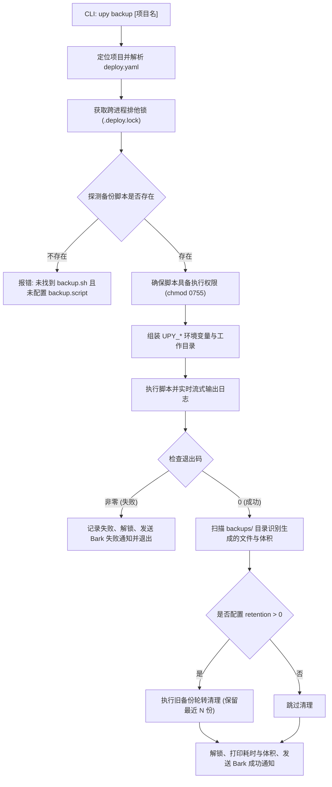

# upy backup 命令架构与设计方案

- **文档状态**：方案设计中 (Draft / Pending Implementation)
- **设计日期**：2026-10-19
- **作者**：Aaron Conlon / Antigravity
- **涉及模块**：`internal/backup/`、`internal/commands/backup.go`、`internal/projectlock/`、`internal/notify/`、`internal/config/`

---

## 一、背景与设计动机

在服务器日常运维与项目迭代过程中，数据的安全性具有最高优先级。无论是生产数据库（MySQL、PostgreSQL、SQLite）、上传的媒体资产、业务配置文件，还是 Docker Compose 的数据持久化卷（Volume），都需要在以下场景下进行可靠备份：
1. **发布新版本前**：防止新版本数据库迁移脚本（Migration）出错或业务逻辑异常导致不可逆的数据损毁。
2. **日常巡检与维护**：周期性自动快照归档关键业务数据。
3. **重大环境调整或数据清理前**：在执行 `clean --purge` 或重装主机前快速打一份基线快照。

### 核心痛点与需求
不同技术栈（Node.js / Go / Python / PHP / Java）与数据引擎（MySQL / PG / SQLite / Redis / 本地静态文件）的备份方式差异极大（如 `mysqldump`、`pg_dump`、`tar` 打包挂载目录等）。通用部署工具如果试图内置所有具体数据库的备份细节，会导致庞大且僵化。

因此最佳设计策略是：**“由项目自身提供特定场景的备份脚本，由 `upy` 统一驱动、注入上下文、加锁防护、归档管理与通知联动”**。

用户执行 `upy backup` 时，`upy` 将作为高可靠的运维执行引擎，完成统一的项目调度、跨进程安全加锁、执行状态监控、归档轮转清理与消息推送。

---

## 二、核心设计原则

1. **零侵入约定优先（Convention over Configuration）**：
   - 默认自动检测项目根目录下的 `backup.sh` 或 `scripts/backup.sh`，无需任何配置即可开箱即用。
   - 支持在 `deploy.yaml` 中自定义脚本位置、备份输出目录与轮转保留策略。
2. **跨进程互斥保护（Project Locking）**：
   - 备份执行期间，自动申请 `internal/projectlock` 排他锁（`action: 备份中`）。
   - 确保备份期间不会发生新版本覆盖部署或历史数据清理，避免备份出半更新的不一致脏数据。
3. **上下文环境变量透传（Context Injection）**：
   - `upy` 为备份脚本注入标准化的系统级环境变量（如项目名、版本号、项目绝对路径、目标归档目录、时间戳等），脚本无需硬编码绝对路径。
4. **统一归档管理与轮转（Retention & Pruning）**：
   - 自动纳管备份产物目录（默认 `<root>/backups/`）。
   - 支持配置最大保留份数（`retention`），自动清理陈旧备份，防止备份文件撑爆磁盘。
5. **通知闭环（Notification Alerting）**：
   - 备份成功或失败时，无缝通过配置的 Bark 等通知渠道推送告警，包含项目名、耗时、产物体积或错误详情。

---

## 三、备份脚本约定与配置规范

### 1. 约定式自动探测
当项目根目录存在以下文件时，`upy backup` 将自动将其识别为备份驱动脚本：
1. `<projectRoot>/backup.sh`
2. `<projectRoot>/scripts/backup.sh`
3. `<projectRoot>/bin/backup.sh`

### 2. `deploy.yaml` 显式配置规范（可选进阶）
在项目根目录的 `deploy.yaml` 中，可配置可选的 `backup` 节点：

```yaml
name: my-app
type: docker
docker:
  mode: compose
  composeFile: docker-compose.yml

# 备份功能配置（可选）
backup:
  script: backup.sh            # 自定义脚本路径（相对项目根目录，缺省自动探测）
  dir: backups                 # 备份产物归档目录（相对项目根目录，默认 backups）
  retention: 7                 # 自动轮转保留的最大备份份数（默认 7，0 表示不自动清理）
  timeout: 10m                 # 备份最大超时时间（默认 15m，支持 30s, 5m, 1h）
  preDeploy: false             # 部署新版本前是否自动触发备份（进阶：部署自动快照）
```

### 3. `upy` 注入给备份脚本的环境变量清单

执行备份脚本时，`upy` 会将当前项目上下文通过环境变量注入子进程：

| 环境变量名 | 说明 | 示例 |
| :--- | :--- | :--- |
| `UPY_PROJECT_NAME` | 项目名称 | `my-api-service` |
| `UPY_PROJECT_ROOT` | 项目根目录绝对路径 | `/var/www/my-api-service` |
| `UPY_BACKUP_DIR` | 建议备份产物存放目录绝对路径 | `/var/www/my-api-service/backups` |
| `UPY_CURRENT_VERSION` | 当前生效运行的版本号 | `v1.2.0`（若无则为空） |
| `UPY_TIMESTAMP` | 标准格式时间戳 | `20261019-094000` |
| `UPY_DEPLOY_TYPE` | 项目部署类型 | `docker` 或 `static` |

#### 典型用户项目 `backup.sh` 示例（Docker Compose + MySQL）：

```bash
#!/usr/bin/env bash
set -euo pipefail

# 确保输出目录就绪
mkdir -p "${UPY_BACKUP_DIR}"

BACKUP_FILE="${UPY_BACKUP_DIR}/dump-${UPY_PROJECT_NAME}-${UPY_TIMESTAMP}.sql.gz"
echo "正在导出数据库到: ${BACKUP_FILE}..."

# 通过 docker compose 执行 mysqldump
docker compose exec -T db mysqldump -u root -p"${DB_PASSWORD}" "${DB_NAME}" | gzip > "${BACKUP_FILE}"

echo "数据库导出成功！"
```

---

## 四、系统架构与执行流程

### 1. 架构流图



### 2. 核心模块分工

```text
internal/
├── backup/
│   ├── backup.go            # 备份引擎: 脚本发现、上下文组装、执行器与产物探测
│   ├── backup_test.go       # 单测: 环境变量传递、退出码判定、产物扫描
│   ├── prune.go             # 轮转策略: 按修改时间排序、保留 Top N、多余文件安全删除
│   └── prune_test.go        # 单测: 轮转删除测试
├── projectlock/
│   └── lock.go              # 跨进程排他锁 (action: 备份)
├── commands/
│   ├── backup.go            # CLI 交互层 (选择项目、参数分发、状态格式化)
│   └── backup_test.go       # 命令层测试
└── notify/
    └── notify.go            # 推送通知事件 (KindBackupSuccess / KindBackupFailure)
```

---

## 五、UX 交互与终端效果设计

### 1. 单项目交互式备份

```text
➜ upy backup
? 请选择要备份的项目:
  ▸ [当前项目] my-api-service (/var/www/my-api-service)
    website-frontend (/var/www/website-frontend)
    [全部已登记项目]

-> 正在锁定项目 my-api-service...
✓ 已获取项目锁 (.deploy.lock)
-> 发现备份脚本: backup.sh
-> 正在驱动执行备份脚本 (UPY_BACKUP_DIR=/var/www/my-api-service/backups)...
--------------------------------------------------------------------------------
正在导出数据库到: /var/www/my-api-service/backups/dump-my-api-service-20261019-094000.sql.gz...
数据库导出成功！
--------------------------------------------------------------------------------
✓ 备份脚本执行完成
  📦 生成备份归档: dump-my-api-service-20261019-094000.sql.gz (42.5 MB)
  🛡️  备份轮转检查: 保留最近 7 份（当前共 3 份，无需清理）
  ⏱  备份总耗时:   3.2s
  🔔 已向 1 个渠道推送备份完成通知
```

### 2. 查看历史备份列表 (`--list`)

```text
➜ upy backup my-api-service --list
项目 my-api-service 历史备份列表 (/var/www/my-api-service/backups):

  文件名称                                               文件体积       生成时间
  dump-my-api-service-20261019-094000.sql.gz           42.5 MB        2026-10-19 09:40:02
  dump-my-api-service-20261018-020000.sql.gz           41.8 MB        2026-10-18 02:00:01
  dump-my-api-service-20261017-020000.sql.gz           40.9 MB        2026-10-17 02:00:03

累计 3 个备份文件，总占用空间: 125.2 MB
```

### 3. 批量备份全部项目 (`--all`)

```text
➜ upy backup --all -y

[1/2] 正在备份项目 my-api-service...
  ✓ 备份成功: dump-my-api-service-20261019-094000.sql.gz (42.5 MB, 耗时 3.2s)

[2/2] 正在备份项目 website-frontend...
  ✓ 备份成功: assets-20261019-094005.tar.gz (18.1 MB, 耗时 1.1s)

🎉 全部 2 个项目备份完成！累计生成备份 60.6 MB
```

---

## 六、CLI 命令行参数设计

```bash
# 1. 交互式选择项目备份
upy backup

# 2. 直接针对指定项目执行备份
upy backup my-api-service

# 3. 指定项目根目录备份
upy backup --root /var/www/my-app

# 4. 批量备份全部已登记项目 (跳过确认)
upy backup --all -y

# 5. 查看项目的历史备份文件列表
upy backup my-api-service --list

# 6. 手动触发备份轮转，保留最近 N 个备份
upy backup my-api-service --prune 5

# 7. 自定义覆盖执行指定的备份脚本
upy backup my-api-service --script ./scripts/custom-dump.sh
```

### 参数定义结构体
```go
type BackupArgs struct {
    ProjectName string // 项目名称
    Root        string // 显式项目根路径
    Script      string // 覆盖默认脚本路径
    List        bool   // 列出已有备份
    Prune       int    // 手动保留最近 N 份备份 (并删除更早的)
    All         bool   // 批量备份所有已登记项目
    Yes         bool   // 跳过交互确认
}
```

---

## 七、关键边界与异常处理规范

1. **备份脚本不存在**：
   - 友好提示当前项目根目录下未发现 `backup.sh`，并指导用户：“请在项目根目录下创建 `backup.sh`，或在 `deploy.yaml` 中配置 `backup.script`”。
2. **并发互斥冲突**：
   - 若项目正在由其他进程执行 `upy release` 或 `upy clean`，由于 `.deploy.lock` 已被锁定，`upy backup` 会立即返回友好提示：
     `“项目正在进行 部署中（PID: 12345），无法获取项目锁，请稍后再试”`。
3. **脚本权限不足**：
   - 若脚本缺少可执行位（`+x`），`upy` 会在执行前自动尝试 `os.Chmod(scriptPath, 0755)`，若失败则回退至通过 `sh <scriptPath>` 显式调度。
4. **执行超时保护**：
   - 引入 `context.WithTimeout`，防止数据库挂起或死锁导致备份进程无限卡死。
5. **空备份目录与轮转容错**：
   - 轮转清理仅匹配当前项目目录下的普通文件，严格避免递归误删子目录或隐藏文件。

---

## 八、开发路线图与实施计划

1. **第一阶段：核心备份引擎开发 (`internal/backup`)**
   - 实现脚本自动发现、上下文组装、超时控制与命令执行器。
   - 实现备份目录产物扫描与体积格式化。
   - 实现保留份数轮转（Pruning）逻辑。
   - 编写完整的单元测试（包含超时控制、异常退出码透传、产物扫描）。
2. **第二阶段：通知联动扩充 (`internal/notify`)**
   - 在 `internal/notify` 中增加 `KindBackupSuccess` 与 `KindBackupFailure` 事件类型。
   - 支持 Bark 标题与副标题格式化输出（例如：`[my-app] 数据备份成功 (42.5MB, 耗时 3.2s)`）。
3. **第三阶段：CLI 命令层实现 (`internal/commands/backup.go`)**
   - 实现交互式单项目与批量项目选择器。
   - 实现 `--list`、`--prune`、`--all` 参数处理。
   - 编写 `commands/backup_test.go` 单测。
4. **第四阶段：全局集成与文档发布**
   - 在 `main.go` 注册 `backup` 子命令与帮助提示。
   - 在 `internal/commands/completion.go` 中注册 Tab 自动补全规则。
   - 更新 `README.md`，添加使用说明与示例。
