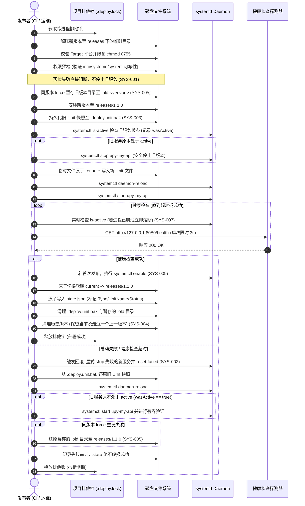

# upy system 类型部署项目（Go 二进制 Web 服务）架构与设计规范

- **文档状态**：已实现并通过真实 systemd 全量 24 项 E2E 验证，随 `v0.2.0` 正式发布
- **设计日期**：2026-10-19
- **作者**：Aaron Conlon / Antigravity
- **涉及模块**：
  - `internal/config/manifest.go`：Manifest 与参数转义（SYS-008、SYS-009）
  - `internal/config/project.go`：服务器端服务配置定义（SYS-001、SYS-009）
  - `internal/state/state.go`：部署状态与 Unit/Status 字段定义（SYS-003）
  - `internal/deployer/system.go`：System 部署器完整生命周期、权限预检、Unit 防串扰与安全回滚（SYS-001、SYS-002、SYS-006、SYS-007）
  - `internal/deploy/deploy.go`：同版本暂存发布、状态提交与回滚版本保留（SYS-003、SYS-004、SYS-005）
  - `internal/cleaner/cleaner.go`：双版本保护与 Purge 服务注销（SYS-004）

---

## 一、架构定位与职责正交划分

在轻量级与现代化的单机部署体系中，Go 编写的后端 Web 服务拥有“单静态二进制、零动态依赖、启动迅速、内存极小”的天然优势。为了避免在单机服务器上引入过重的容器运行时或复杂的编排栈，最经典的生产级架构是：

$$\text{Nginx / Caddy (公网反代/SSL)} \longrightarrow \text{upy 管版本与发布} \longleftrightarrow \text{systemd (进程守护/cgroups)} \longleftrightarrow \text{Go 二进制服务 (127.0.0.1:8080)}$$

### 职责边界正交划分
1. **upy**：负责制品拉取、解压、版本目录归档、权限修复、systemd unit 模板生成与原子切换、HTTP 健康检查、自动回滚以及旧版本安全清理。
2. **systemd**：负责底层 OS 级进程生命周期管理、失败自动重启 (`Restart=on-failure`)、资源限制 (cgroups)、标准输出采集到 `journald`、标准信号 (`SIGTERM`) 优雅停机。
3. **Nginx / Caddy**：负责 80/443 入口流量终结、自动 HTTPS 证书续期，反向代理转发到本地监听地址（如 `127.0.0.1:8080`）。

| 组件 | 核心职责 | 不做的事情 |
| :--- | :--- | :--- |
| **upy** | 版本拉取、归档、Unit 模板生成与原子切换、HTTP 存活探测、自动回滚、历史清理 | 不接管进程常驻轮询、不做死循环守护 |
| **systemd** | 进程常驻守护、故障就地重启（`Restart=on-failure`）、cgroups 限制、`journald` 日志、`SIGTERM` 转发 | 不做版本发布回滚（systemd 重启只针对同版本） |
| **Nginx / Caddy** | 80/443 入口流量代理、自动 HTTPS、反代转发到 `127.0.0.1:8080` | 不参与后端二进制部署与版本管理细节 |

---

## 二、交付物规范（Bundle 规范）

开发者在 CI（如 GitHub Actions）中编译目标平台的二进制产物，打成统一格式的 `bundle.zip`：

```text
bundle.zip
├── deploy.yaml          <-- Bundle 清单文件
└── bin/
    └── my-api           <-- 编译好的可执行程序
```

### 1. Bundle 内 `deploy.yaml` 规格定义

```yaml
name: my-api
version: 1.0.0
type: system             # 声明为系统原生服务部署类型（解析层自动归一兼容别名 service）
target:
  os: linux
  arch: amd64            # 校验目标系统与硬件架构
system:
  command: ["./bin/my-api", "--port", "8080"]  # 启动命令及参数列表，严格转义与防注入
  workingDir: ""                               # 可选，默认指向具体版本目录 releases/<version>
healthcheck:
  url: http://127.0.0.1:8080/health            # 本地存活探测端点
  timeout: 30s                                 # 超时时间（默认 30s，单次探测限时 3s）
```

> [!NOTE]
> **产物与服务器环境彻底解耦**：
> Bundle 内部只描述产物如何被执行与健康检查探针；而服务的系统运行用户（`User`）、环境变量（`service.env`）和持久化业务数据（`shared/data/`）属于服务器的本地环境状态，绝不应由 Release Bundle 侵入篡改。

---

## 三、服务器端目录布局与数据隔离

在服务器部署目录（例如 `/opt/my-api/`）中，采用兼顾**不可变版本隔离**与**跨版本数据共享**的目录结构：

```text
/opt/my-api/
├── deploy.yaml                      <-- 服务器端全局配置（发布源、服务运行账号、保留策略）
├── current -> releases/1.1.0        <-- [符号链接] 当前成功发布的版本（供运维速查）
├── state.json                       <-- upy 状态机记录（当前版本、上一版本、Unit 登记、状态）
├── .deploy.lock                     <-- 跨进程文件排他互斥锁
├── .deploy.unit.bak                 <-- [事务快照] 部署期间的 Unit 磁盘备份（用于崩溃恢复）
├── shared/                          <-- [持久化存储] 跨版本保留的共享资产（Purge 亦受保护）
│   ├── service.env                  <-- 环境变量文件（如 LISTEN_ADDR, DATA_DIR）
│   └── data/                        <-- 业务持久化数据目录（SQLite、用户上传等）
├── bundles/                         <-- Release 压缩包下载缓存
└── releases/                        <-- [不可变版本仓库] 只读业务程序
    ├── 1.0.0/                       <-- 上一版本（保留以供秒级安全回滚）
    │   ├── deploy.yaml
    │   └── bin/my-api
    └── 1.1.0/                       <-- 当前活跃版本
        ├── deploy.yaml
        └── bin/my-api
```

### 1. 环境变量与持久化约定
在 `/opt/my-api/shared/service.env` 中：
```bash
LISTEN_ADDR=127.0.0.1:8080
DATA_DIR=/opt/my-api/shared/data
APP_ENV=production
```
- Go 业务程序启动时必须读取 `LISTEN_ADDR` 和 `DATA_DIR`。
- 版本升级或回滚时，`releases/` 内的文件随版本替换，而 `shared/data/` 与 `shared/service.env` 始终保持完好。

### 2. 服务器端配置定义 (`/opt/my-api/deploy.yaml`)
```yaml
name: my-api
release:
  provider: github
  repository: acme/my-api
  asset: bundle.zip
service:
  user: my-api          # 运行服务的操作系统低权限账号（默认与 slug 相同）
  group: my-api         # 运行用户组
  unit: upy-my-api.service # 自定义 unit 名称（默认 upy-<slug>.service）
releases:
  keep: 2               # 保留当前版本与最近一个稳定旧版本
```

---

## 四、systemd Unit 规范与启动策略

由 `upy` 在系统目录生成命名稳定的 Unit 文件，规则为 `upy-<name>.service`（例如 `/etc/systemd/system/upy-my-api.service`）：

```ini
# Managed by upy - DO NOT EDIT MANUALLY
# X-Upy-Project: my-api
# X-Upy-Root: /opt/my-api

[Unit]
Description=my-api managed by upy
After=network.target
Wants=network-online.target

[Service]
Type=exec
User=my-api
Group=my-api
WorkingDirectory=/opt/my-api/releases/1.1.0
ExecStart=/opt/my-api/releases/1.1.0/bin/my-api --port 8080
EnvironmentFile=-/opt/my-api/shared/service.env
Restart=on-failure
RestartSec=3s
TimeoutStopSec=30s
KillSignal=SIGTERM
StandardOutput=journal
StandardError=journal
NoNewPrivileges=true
PrivateTmp=true

[Install]
WantedBy=multi-user.target
```

### 核心安全与稳定性设计
1. **Unit 指向具体版本目录**：
   - 杜绝软链竞争：若 Unit 指向 `current/bin/my-api`，旧进程优雅停机期间如果动态读取磁盘静态资源或子进程，将踩到新版本文件造成脏读。
   - 进程确定性：`systemctl status` 和 `/proc/<pid>/cmdline` 能一眼识别实际运行版本。
2. **所有权防串扰与防劫持（SYS-006）**：
   - Unit 头部显式注入 `# X-Upy-Project: <name>` 与 `# X-Upy-Root: <path>` 元数据注释。
   - 操作前检查既有 Unit：若非 upy 纳管（无 upy 标记）或 `X-Upy-Root` 与当前项目根不一致，**坚决拒绝接管或覆盖**，杜绝不同目录同名服务串扰和系统服务劫持。
3. **参数转义与防注入（SYS-008）**：
   - 严格转义 `%` 为 `%%`，防止触发 systemd specifier；
   - 严格转义 `$` 为 `$$`，防止触发 systemd 环境变量非法求值；
   - 包含空格或特殊字符的参数使用双引号包裹，拒绝 `\r`、`\n`、`\0` 等控制字符。

---

## 五、发布生命周期、故障回滚与崩溃恢复

### 1. 发布全流程序列



### 2. 回滚与异常恢复机制（SYS-002、SYS-003、SYS-005）
1. **Prepare 阶段与 Rollback 边界划分**：
   - `Prepare` 阶段是在停止旧服务和更新 unit 之前执行的静态与环境预检（架构校验、可执行文件存在性、用户存在性、跨项目/外部 Unit 归属校验、Unit 文件写权限等）。
   - 若 `Prepare` 阶段出错，直接阻断退出，**严禁触发 Rollback 逻辑**。由于此时尚未停止旧服务且未写入新 unit，不应执行任何停机或删除动作，确保原本健康运行的历史服务和非 upy unit 完全不受影响。
2. **停止新服务并清除失败限制**：
   - 启动或探测失败时，新服务可能仍在运行并占用端口，或处于 `Restart=on-failure` 频繁重启循环。
   - 回滚第一步必须显式调用 `systemctl stop <unit>` 确保进程组退出，并执行 `systemctl reset-failed <unit>` 清空失败计数器。
3. **按原始状态决定是否启动旧服务**：
   - 若旧服务在部署前原本处于停止状态，回滚恢复旧 Unit 后**保持停止**，不擅自启动。
   - 仅当旧服务原本为活跃状态（`wasActive == true`）且已被本次停掉时，才启动旧服务并进行有界存活性验证。
4. **首次部署失败的安全注销**：
   - 若为首次部署（无历史 Unit 快照），回滚执行 `systemctl disable <unit>`，删除新建的 Unit 文件，`daemon-reload` 并清理残留，不留下幽灵自启服务。
5. **同版本 force 重发的无损恢复与真实健康验证**：
   - 同版本 force 部署采用暂存置换模式，旧版本目录保存在 `.old-<version>-<timestamp>`。
   - 回滚时必须**在启动旧服务之前**还原旧版本目录，随后启动旧服务并执行有界的真实健康检查，确保恢复后的旧服务不仅处于 active 且响应正常。

---

## 六、关键约定与工程考量

### 1. 权限模型与运行账号安全（SYS-001）
- **权限边界明确**：更新 `/etc/systemd/system/upy-*.service` 必须拥有该目录的写权限。
- **严格预检（Pre-flight Check）**：
  在 `Prepare()` 阶段即执行 Unit 目录与文件的可写性探测。若无权写入，**在停止旧服务前即刻抛出明确错误并阻断**，杜绝“先停旧服务，再因缺权无法启动新服务”造成的灾难性停机。
- **运行账号真实性强制校验，杜绝静默提权**：
  若配置了 `service.user` 或 `service.group`，`Prepare()` 阶段必须调用底层系统接口校验该用户及组是否在宿主操作系统中真实存在。若不存在，立即报错阻断，**严禁静默回退或降级至 root 身份启动服务**。
- **服务运行账号最小权限**：
  服务运行用户（如 `my-api`）为独立的系统无登录账号（`nologin`），仅对 `shared/data/` 拥有读写权限，无权篡改 `releases/` 下的程序产物或部署配置。

### 2. 参数保真度与转义（SYS-008）
- 对于数组形式的启动命令参数 `command: ["./bin/my-api", "arg1", ""]`，解析层完整保留所有参数项（包括空字符串 `""` 及首尾带有空白字符的参数 `  padded  `）。
- 针对转义规则，空参数严格转义为 `""`，带空格或引号的参数自动进行外层包裹与转义，确保 systemd 解析后的 argv 与原始声明 100% 保持一致。

### 3. 存活探针与身份校验（SYS-007）
- `PollHealth` 内置单次 HTTP 请求 3 秒超时限制及 4096 字节响应上限，避免网络悬挂或恶意响应阻塞。
- 探测期间结合 `systemctl is-active` 协同验证：若在等待探测就绪期间进程发生异常退出或崩溃，探针立即熔断失败，无需盲目等待 30 秒超时。
- **探针身份防假冒校验**：针对探测本地端口（127.0.0.1 / localhost）的场景，探针校验当前监听该端口的 PID 是否为 systemd 服务的主进程 PID（通过 `/proc/<pid>/fd` 与 `/proc/net/tcp` 检查套接字所有权），若响应 JSON 包含 version 或 pid 亦进行比对，防止目标服务启动失败时被本地其他监听相同端口的无关进程欺骗而误判部署成功。

### 4. 清理策略与部署中断恢复保护（SYS-004）
- **双版本保护（Current + Previous）**：
  - 自动清理 `cleanupOldReleases`：保留当前版本与最近一个上一版本，确保随时可手动或自动切回上一版本。
  - 手动清理 `upy clean`：`AnalyzeProject` 同时保护 `CurrentVersion`、软链指向版本及 `PreviousVersion`。
- **部署中断恢复保护**：
  - 若在旧服务已停止、新 Unit 已生效但部署流程（如健康检查中途）被意外强杀中断，`state.json` 可能仍记录旧版本，而 Unit 实际指向新版本。
  - `clean` 在分析可清理版本时，会实时读取对应 systemd unit 文件中的 `WorkingDirectory` 与 `ExecStart`，提取当前正在运行或被引用的版本路径，将其纳入核心保护集合，严防 clean 误删正在被 systemd 引用的新版本。
- **彻底卸载（`clean --purge`）**：
  - 识别当前项目登记或纳管的 Unit，验证归属后执行：`systemctl stop` -> `systemctl disable` -> 删除 unit 文件 -> `daemon-reload` -> `reset-failed`。
  - 彻底清理 `releases/`、`bundles/`、`current` 软链与 `state.json`。
  - **`shared/` 持久化业务数据（SQLite、用户上传）默认予以保留**，防止不可逆业务损失。

### 4. 停机窗口透明化（SYS-010）
- 本方案第一版定位为**有界停机发布（先停后启）**。
- 停机窗口由服务正常退出耗时、Unit reload 耗时及新服务启动建连耗时决定（受 `TimeoutStopSec` 上限保护）。
- 绝不虚报“零停机”；后续多实例热发布（双端口或 `SO_REUSEPORT` 平滑切流）可在后续阶段独立演进。

---

## 七、实现模块与数据结构设计

### 1. `internal/config/manifest.go`
```go
type ManifestSystem struct {
	Command          any                  `yaml:"command"`    // string 或 []string
	WorkingDirectory string               `yaml:"workingDir"` // 默认指向 releaseDir
	Healthcheck      *ManifestHealthcheck `yaml:"healthcheck"`
}

type Manifest struct {
	Name        string               `yaml:"name"`
	Version     string               `yaml:"version"`
	Type        string               `yaml:"type"` // static | docker | system (自动归一 service)
	Target      *ManifestTarget      `yaml:"target"`
	Static      *ManifestStatic      `yaml:"static"`
	Docker      *ManifestDocker      `yaml:"docker"`
	System      *ManifestSystem      `yaml:"system"`
	Healthcheck *ManifestHealthcheck `yaml:"healthcheck"`
}

// EscapeSystemdArg 对 ExecStart 参数进行严格转义
func EscapeSystemdArg(arg string) (string, error)
```

### 2. `internal/state/state.go`
```go
type State struct {
	CurrentVersion  string `json:"currentVersion"`
	PreviousVersion string `json:"previousVersion"`
	DeployedAt      string `json:"deployedAt"`
	Type            string `json:"type,omitempty"`
	UnitName        string `json:"unitName,omitempty"`
	Status          string `json:"status,omitempty"` // active | degraded | failed
}
```

### 3. `internal/config/project.go`
```go
type ProjectService struct {
	User  string `yaml:"user"`
	Group string `yaml:"group"`
	Unit  string `yaml:"unit"`
}

type ProjectConfig struct {
	Name     string          `yaml:"name"`
	Release  *ProjectRelease `yaml:"release"`
	Releases ProjectReleases `yaml:"releases"`
	Service  *ProjectService `yaml:"service"` // 服务器端系统服务定义
}
```

---

## 八、总结

通过严格落实 SYS-001 至 SYS-010 的各项改进，`upy` 的 `system` 部署器具备了真正工业级的健壮性：
- **安全第一**：缺权预检、防跨项目串扰、参数严格转义；
- **回滚确定**：先停后退、进程彻底清理、原始状态忠实保护、同版本重发无损还原；
- **全生命周期闭环**：双版本生命线保护、Purge 服务彻底注销、持久化数据严格隔离。
- 完整实现了 Go 原生二进制 Web 服务的极速、轻量与生产级稳定发布。
